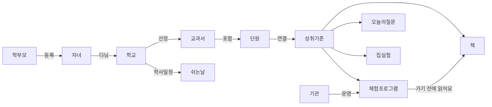

# 도메인 정의서

> 기준: [설계 문서](superpowers/specs/2026-11-06-eduapp-design.md) · 2026-11-06

eduApp은 **"아이가 지금 학교에서 배우는 것"** 을 중심으로 책·집 활동·체험 프로그램을 잇는 서비스다. 모든 추천은 **성취기준**을 통해 연결된다.

## 1. 핵심 개념 지도

## 2. 용어

| 용어 | 정의 | 비고 |
|---|---|---|
| **학부모** | 앱 사용자. 로그인 필수 | v1 사용자는 학부모뿐 |
| **운영자** | 집 실험을 승인하는 사람 (서비스 운영자 본인) | `profiles.is_operator` |
| **자녀** | 학부모가 등록한 초등학생. 학교 1곳·학년 1개 | 한 학부모가 여러 명 등록 가능 |
| **관심 지역** | 체험 프로그램을 볼 지역. 복수 선택 | 서울·경기의 시도 또는 시군구 |
| **학교** | 서울·경기 초등학교. 나이스 학교 목록에서 미리 적재 | 약 1,900곳 (대략) |
| **학교 수집 상태** | 학교 교과서 정보 수집 단계 | 미요청 → 대기 → 완료 / 실패 / 공지 없음 |
| **성취기준** | 국가 교육과정이 정한 학년군·교과별 학습 목표. 예: `[4과05-01]` | 출판사와 무관한 **공통 연결 키** |
| **교과서** | 교육과정·교과·학년·학기·출판사로 구분되는 책 | 초3~6 수학·사회·과학 등은 검정 → 학교마다 다름 |
| **단원** | 교과서의 장. 하나 이상의 성취기준에 매핑 | 출판사 사이트에서 수집되면 표시 |
| **학교 교과서** | 특정 학교·학년·교과에서 쓰는 교과서 | 확인됨 / 확인 중, 출처(자동·학부모) |
| **예상 진도** | 학사일정과 성취기준 순서로 추정한 이번 주 학습 내용 | 항상 "예상"으로 표시 |
| **쉬는 날** | 학사일정 중 방학·재량휴업일 | 체험 추천 필터에 사용 |
| **기관** | 체험 프로그램 운영처 (박물관, 과학관, 청소년시설 등) | v1 핵심 10~20곳 |
| **체험 프로그램** | 기관이 여는 교육·체험 행사. 진행 중/예정만 노출 | 신청은 기관 사이트에서 |
| **신청 시작/마감** | 프로그램 신청 가능 기간 | 시작 시각 비공개 기관은 기간만 |
| **관심 표시** | 학부모가 프로그램을 저장한 것. 알림 대상 | |
| **가기 전에 읽어요** | 체험 전 읽으면 좋은 책 + 이유 1~2문장 | AI 생성 |
| **오늘의 질문** | 예상 진도에 맞춘 식탁 대화 질문 + 생각 힌트 | 하루 1개 |
| **집 실험** | 집 재료로 하는 교과 연계 실험·만들기 | 운영자 승인 후 노출 |
| **배치** | 매일 새벽 Claude 예약 작업이 하는 수집·AI 생성 | 실시간 생성 없음 |

## 3. 규칙 (도메인 불변식)

1. 지역은 **서울·경기**만.
2. 학년은 **초등 1~6**. 초등 대상이 아닌 프로그램은 수집하지 않는다.
3. **마감·종료된 프로그램은 보이지 않는다.**
4. 확인되지 않은 교과서 정보는 반드시 **"확인 중"** 으로 표시한다.
5. 학부모는 **자기 자녀의 학교·학년** 교과서만 고칠 수 있고, 고친 값은 "확인됨"이 된다.
6. 집 실험은 **승인된 것만** 보인다. 불·칼·화학약품을 쓰는 활동은 승인하지 않는다.
7. 자녀를 등록하면 그 학교가 **수집 대기**로 바뀌고, 다음 배치에서 처리된다.
8. 학부모는 **자기 데이터**(자녀, 관심 지역, 관심 프로그램, 알림)만 볼 수 있다.

## 4. 외부 데이터 출처

| 데이터 | 출처 | 방식 |
|---|---|---|
| 학교 목록, 학사일정 | 나이스 교육정보 개방 포털 | Open API |
| 성취기준 | 국가교육과정정보센터(NCIC) | 수집 |
| 교과서 목록 | 교육부 교과서 정보 (공공데이터포털) | 파일 |
| 학교별 교과서 | 각 학교 홈페이지 공지 첨부(hwp/pdf) | 수집 + AI 추출 |
| 체험 프로그램 | 기관 홈페이지 / 공공 API | 수집 |
| 책 | 교과 연계 도서, 도서관 정보나루 | 수집 + AI 연결 |
