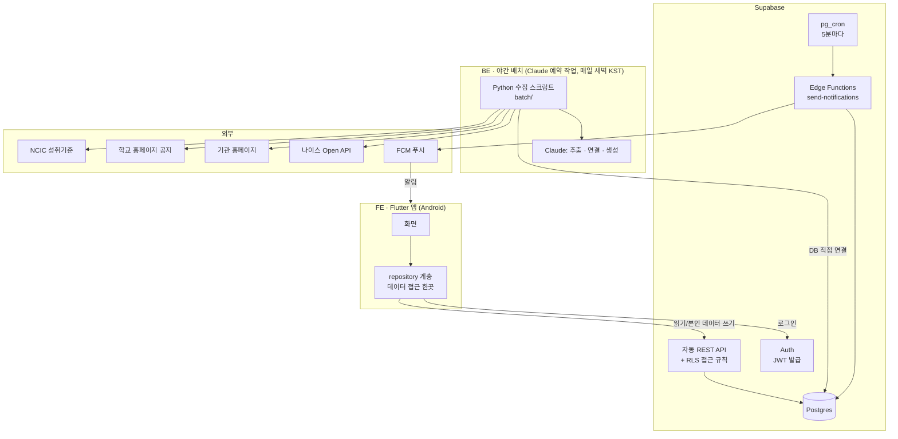
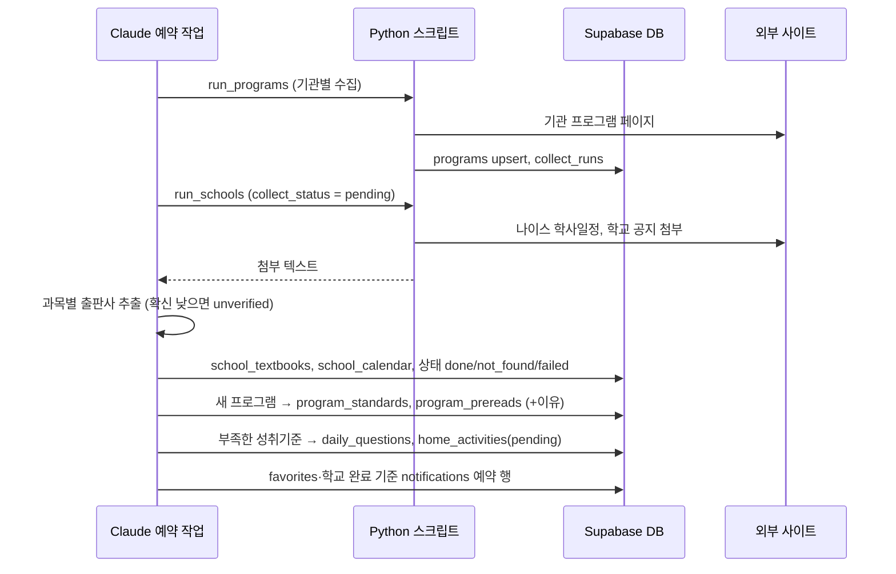

# 아키텍처

> 기준: [설계 문서](superpowers/specs/2026-11-06-eduapp-design.md) · [프로젝트 원칙](05-project-principles.md) · 2026-11-06

## 1. 전체 구성

## 2. 구성 요소별 책임

| 구분 | 구성 요소 | 책임 | 코드 위치 |
|---|---|---|---|
| FE | Flutter 앱 | 화면, 로그인, 자녀·지역 선택, 알림 수신(FCM 토큰 등록) | `app/` |
| BE | Supabase Auth | 로그인, JWT 발급 | (설정) |
| BE | 자동 REST API + RLS | 데이터 조회, 본인 데이터 쓰기, 권한 확인 | `supabase/schema.sql` |
| BE | DB 함수·트리거 | 자녀 등록 → 학교 수집 요청, 학부모 교과서 수정 | `supabase/schema.sql` |
| BE | Edge Function `send-notifications` | `notifications`에서 시각이 된 알림을 FCM으로 발송 | `supabase/functions/` |
| BE | pg_cron | 5분마다 `send-notifications` 호출 | `supabase/migrations/` |
| BE | 야간 배치 | 수집, AI 생성, 알림 예약 행 생성 | `batch/` |
| DB | Postgres | 모든 데이터 | [ERD](07-erd.md) |

## 3. 야간 배치 순서

## 4. 알림 흐름

1. 배치가 `notifications(send_at)` 행을 만든다: 관심 프로그램의 신청 시작 1일 전·1시간 전, 마감 임박(마감 1일 전), 학교 수집 완료 즉시.
2. pg_cron이 5분마다 Edge Function 호출 → `send_at <= now() and sent_at is null` 행을 FCM으로 보내고 `sent_at` 기록.
3. 관심 표시가 배치 이후에 생기면 Edge Function이 아닌 **DB 트리거**로 알림 행을 바로 만든다 (계획 5에서 구현).

## 5. 보안

- 앱에는 Supabase **anon 키만**. 서비스 키, 나이스 키, DB 연결 문자열은 배치 환경 시크릿과 Edge Function 시크릿에만.
- 자녀·관심·알림은 RLS로 본인만. 운영자 권한은 `profiles.is_operator`, 사용자가 스스로 켤 수 없음.
- 학부모의 교과서 수정은 `correct_school_textbook()` 함수로만, 본인 자녀의 학교·학년에 한정.

## 6. 확장 시점

| 신호 | 바꿀 것 |
|---|---|
| 공개 출시 | 배치의 AI 단계를 Claude API로 (프롬프트는 `batch/`에 있음) |
| 실시간 AI 기능 필요 | Edge Function 또는 별도 API 서버 추가, 앱은 repository 계층만 수정 |
| 지역 확장 | `sido` enum 확장, 기관 수집기 추가 |
