# ERD

> 원본: [`supabase/schema.sql`](../supabase/schema.sql) · 2026-11-06
> 표의 "앱 권한"은 RLS 기준이다.

```mermaid
erDiagram
  profiles ||--o{ children : "등록"
  profiles ||--o{ user_regions : "관심 지역"
  profiles ||--o{ favorites : "관심 표시"
  profiles ||--o{ notifications : "받음"
  profiles ||--o{ device_tokens : "기기"
  schools ||--o{ children : "다님"
  schools ||--o{ school_textbooks : "선정"
  schools ||--o{ school_calendar : "학사일정"
  textbooks ||--o{ school_textbooks : ""
  textbooks ||--o{ textbook_units : "포함"
  textbook_units ||--o{ unit_standards : ""
  achievement_standards ||--o{ unit_standards : ""
  achievement_standards ||--o{ program_standards : ""
  achievement_standards ||--o{ book_standards : ""
  achievement_standards ||--o{ daily_questions : ""
  achievement_standards ||--o{ home_activities : ""
  institutions ||--o{ programs : "운영"
  programs ||--o{ program_standards : "연결 단원"
  programs ||--o{ program_prereads : "가기 전에 읽어요"
  books ||--o{ program_prereads : ""
  books ||--o{ book_standards : ""
  programs ||--o{ favorites : ""
  programs ||--o{ notifications : ""
  schools ||--o{ notifications : "교과서 준비"

  profiles {
    uuid id PK "auth.users"
    text display_name
    boolean is_operator
  }
  children {
    bigint id PK
    uuid parent_id FK
    text nickname
    bigint school_id FK
    int grade "1-6"
  }
  user_regions {
    uuid user_id PK
    sido sido PK
    text sigungu PK
  }
  device_tokens {
    text token PK
    uuid user_id FK
    text platform
  }
  schools {
    bigint id PK
    text neis_code UK
    text name
    sido sido
    collect_status collect_status
  }
  school_textbooks {
    bigint school_id PK
    int grade PK
    text subject PK
    bigint textbook_id FK
    info_confidence confidence
    info_source source
  }
  school_calendar {
    bigint school_id PK
    date day PK
    text event_name PK
    boolean is_holiday
  }
  achievement_standards {
    text code PK
    text subject
    int grade_min
    int grade_max
    int seq
  }
  textbooks {
    bigint id PK
    text subject
    int grade
    int semester
    text publisher
  }
  textbook_units {
    bigint id PK
    bigint textbook_id FK
    int seq
    text title
  }
  unit_standards {
    bigint unit_id PK
    text standard_code PK
  }
  institutions {
    bigint id PK
    text key UK
    text name
    sido sido
  }
  programs {
    bigint id PK
    bigint institution_id FK
    text source_id
    int grade_min
    int grade_max
    date starts_on
    date ends_on
    timestamptz apply_starts_at
    timestamptz apply_ends_at
  }
  program_standards {
    bigint program_id PK
    text standard_code PK
    text reason
  }
  books {
    bigint id PK
    text isbn UK
    text title
    int grade_min
    int grade_max
  }
  book_standards {
    bigint book_id PK
    text standard_code PK
    text reason
  }
  program_prereads {
    bigint program_id PK
    bigint book_id PK
    text reason
  }
  daily_questions {
    bigint id PK
    text standard_code FK
    text question
    text hint
  }
  home_activities {
    bigint id PK
    text standard_code FK
    text title
    review_status status
  }
  favorites {
    uuid user_id PK
    bigint program_id PK
  }
  notifications {
    bigint id PK
    uuid user_id FK
    notification_kind kind
    timestamptz send_at
    timestamptz sent_at
  }
```

## 테이블 요약

| 영역 | 테이블 | 채우는 곳 | 앱 권한 |
|---|---|---|---|
| 사용자 | `profiles`, `children`, `user_regions`, `device_tokens` | 앱 | 본인 읽기·쓰기 |
| 학교 | `schools` | 배치(나이스 목록 적재), 트리거(수집 요청) | 읽기 |
| | `school_textbooks` | 배치(자동), 학부모(`correct_school_textbook`) | 읽기 + 함수로 수정 |
| | `school_calendar` | 배치(나이스) | 읽기 |
| 교육과정 | `achievement_standards`, `textbooks`, `textbook_units`, `unit_standards` | 배치 | 읽기 |
| 체험 | `institutions`, `programs` | 배치 | 읽기 (`upcoming_programs` 뷰 사용) |
| 추천 | `books`, `program_standards`, `book_standards`, `program_prereads`, `daily_questions` | 배치(AI) | 읽기 |
| | `home_activities` | 배치(AI, pending) → 운영자 승인 | 승인된 것만 읽기, 운영자 수정 |
| 관심·알림 | `favorites` | 앱 | 본인 |
| | `notifications` | 배치·트리거 → Edge Function 발송 | 본인 읽기 |
| 운영 | `collect_runs` | 배치 | 없음 |

## 주요 규칙 (DB에서 강제)

- 학년 `1~6`, 지역 `서울/경기` — check / enum
- 프로그램 중복 방지 — `unique (institution_id, source_id)`
- 같은 알림 중복 방지 — `unique nulls not distinct (user_id, kind, program_id, school_id)`
- 자녀 등록 → 학교 `pending` — 트리거 `children_request_collect`
- 마감 프로그램 숨김 — 뷰 `upcoming_programs`
