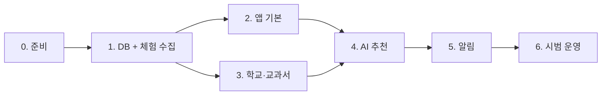

# 개발 계획 (로드맵)

> 기준: [PRD](02-prd.md) · [아키텍처](06-architecture.md) · [스키마](../supabase/schema.sql) · 2026-11-06
> 각 단계는 끝나면 단독으로 동작·테스트 가능한 결과물을 낸다. 상세 계획은 단계 시작 시 `docs/superpowers/plans/`에 작성한다.

| 단계 | 내용 | 산출물 | 완료 기준 | PRD | 상세 계획 |
|---|---|---|---|---|---|
| **0. 준비** | Supabase 프로젝트, 환경 네트워크 Full, Firebase 프로젝트(FCM) | 키·URL을 환경 시크릿에 등록 | 배치 환경에서 Supabase DB 접속 성공 | — | 사용자 작업 |
| **1. DB + 체험 수집** | `schema.sql` 적용, 날짜·학년 파서, upsert, 기관 수집기 2곳 → 10곳, 예약 작업 | `supabase/`, `batch/` | 매일 새벽 수집, `upcoming_programs` 10개 기관 이상 | F4 데이터 | [계획 1](superpowers/plans/2026-11-06-plan1-db-and-program-collection.md) |
| **2. 앱 기본** | 서울·경기 초등학교 목록 적재(나이스), Flutter 프로젝트, 로그인(이메일), 자녀 등록(학교 검색), 관심 지역, 체험 목록·상세, 관심 표시, 스타일 가이드 적용 | `app/`, `batch/` | 실기기에서 S1·S2(알림 제외) 시나리오 통과 | F1~F5, F6 일부 | [계획 2](superpowers/plans/2026-11-06-plan2-flutter-app-basics.md) |
| **3. 학교·교과서** | 나이스 학사일정 적재, 수집 대기 처리, 공지 첨부(hwp/pdf) 텍스트 추출, 출판사 추출, 우리 학교 화면, 학부모 수정 | `batch/`, `app/` | 시범 학교 5곳 중 4곳 자동 수집 성공, S3·S4 통과 | F7, F4 쉬는 날 | [계획 3](superpowers/plans/2026-11-07-plan3-school-textbooks-calendar.md) |
| **4. AI 추천** | 성취기준·교과서 목록 적재, 프로그램↔성취기준 연결, 가기 전에 읽어요, 예상 진도, 책, 오늘의 질문, 집 실험 + 운영자 승인 화면 | `batch/prompts/`, `app/` | 노출 프로그램 80% 이상 연결, S5~S7 통과 | F5, F9~F13 | 작성 예정 |
| **5. 알림** | FCM 토큰 등록, 알림 예약 행 생성, pg_cron + Edge Function 발송 | `supabase/functions/`, `app/` | 관심 프로그램 알림이 정해진 시각 ±5분에 도착 | F6, F8 | 작성 예정 |
| **6. 시범 운영** | 지인 배포(내부 테스트 트랙), 사용량·처리량 측정, 피드백 | 운영 기록 | PRD 성공 기준 측정 | — | — |

## 사용자가 해야 할 일

| 시점 | 할 일 |
|---|---|
| 1단계 Task 4 전 | 환경 네트워크 접근을 Full로 |
| 1단계 Task 7 전 | Supabase 프로젝트 생성, `DATABASE_URL` 환경 시크릿 등록 |
| 2단계 전 | 나이스 Open API 인증키 (`NEIS_API_KEY` 환경 시크릿) |
| 2단계 전 | 안드로이드 빌드용 `dl.google.com` 허용 (Full이면 불필요) |
| 3단계 시범 실행 전 | 시범 학교 5곳 선정 (경기 goeay.kr 4곳 이상), 원격 DB에 20261108000001_school_info 마이그레이션 적용 승인 |
| 5단계 전 | Firebase 프로젝트 생성, 서비스 계정 키 |
| 6단계 전 | Google Play 개발자 계정 (내부 테스트 배포용) |
